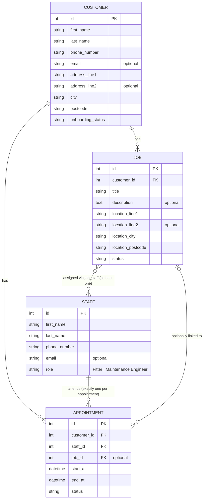

# Smarti — CRM & Job Management

A small web CRM for a business that manages customers, appointments, fitters and maintenance engineers. Built with Flask, server-rendered Jinja templates and SQLite.

It covers the four areas in the brief:

| Brief | What the app does |
|---|---|
| A. Customer management | Add, list, view and edit customers (name, contact details, UK address) |
| B. Customer onboarding | Each customer has an onboarding status (New Enquiry → In Progress → Active, plus Cancelled), changed through allowed moves only |
| C. Appointment booking | Book an appointment for a customer with a date, time, duration and one staff member; see overdue, upcoming and cancelled appointments; double-booking is prevented |
| D. Fitters & maintenance | Maintain a list of fitters and maintenance engineers; create jobs, assign one or more staff, and track job status (Pending, In Progress, Completed, Cancelled) |

---

## A. Getting started

### Requirements

- Python 3.10 or newer (developed on Python 3.12, Windows 11)
- Git

### 1. Install

```bash
cd smarti-job
python -m venv venv
```

Activate the virtual environment:

```bash
# Windows (PowerShell)
.\venv\Scripts\Activate.ps1
# If PowerShell says "running scripts is disabled", run this once, then activate again:
# Set-ExecutionPolicy -Scope CurrentUser RemoteSigned

# macOS / Linux
source venv/bin/activate
```

Install the pinned dependencies:

```bash
pip install -r requirements.txt
```

### 2. Set up the database and test data

```bash
flask --app app seed
```

This creates the SQLite database in the `instance/` folder and loads sample data: 4 customers at different onboarding stages, 3 staff (fitters and a maintenance engineer), 2 jobs and 3 appointments (one past, two upcoming).

> `flask seed` **drops and recreates all tables** — run it again any time you want a clean dataset.

### 3. Run the app

```bash
flask --app app run
```

Open <http://127.0.0.1:5000>. The home page redirects to the customer list.

`SECRET_KEY` has a development default. To set your own before running: `$env:SECRET_KEY="..."` (Windows PowerShell) or `export SECRET_KEY=...` (macOS / Linux).
### 4. Run the automated tests

```bash
pytest -v
```

18 tests run against a fresh in-memory database, so they never touch your data.

### 5. Test the main functionality by hand

Start from a freshly seeded database.

**Customers and onboarding (A, B)**
1. **Customers → Add customer.** Save with valid details. You land on the customer's page with status **New Enquiry**.
2. Try invalid input: postcode `ABC 123`, phone `12345`, email `nope`, or a blank first name. Each shows an error under the field, keeps what you typed and saves nothing. A postcode typed as `ls6 2ab` is saved as `LS6 2AB`.
3. **Edit** the customer and change some details.
4. On the customer page, the status dropdown offers only the allowed next moves. From New Enquiry you can go to In Progress or Cancelled, but not straight to Active.
5. *(Optional)* In the browser devtools, change a status `<option>` value to a move that isn't allowed and submit it. The server refuses it and the status is unchanged.

**Staff (D)**
6. **Staff → Add staff member.** The role must be picked deliberately (there's no default). **Edit** an existing staff member. The list shows each person's open jobs (Pending or In Progress).

**Jobs (D)**
7. **Jobs → Create job.** Pick a customer, a job location and at least one staff member. Saving with no staff shows "Select at least one staff member."
8. On the job page, move the status through Pending → In Progress → Completed. A completed job can be reopened but not cancelled.

**Appointments (C)**
9. **Appointments → Book appointment.** In the seed data Mark Evans is booked tomorrow 09:00–10:00. Try these:
   - Mark, tomorrow, 09:30, 60 min → **refused**: "Mark Evans is already booked 09:00–10:00 with …"
   - Mark, tomorrow, 10:00, 60 min → **saved** (back-to-back is allowed)
   - Another staff member, tomorrow, 09:00 → **saved** (different person)
   - Any date or time in the past → **refused**
   - A job that belongs to a different customer → **refused**
10. Cancel an appointment from the **Upcoming** section. It moves to **Cancelled** and no longer blocks that time slot.

---

## B. Architecture & design decisions

### Technology choices

| Choice | Why |
|---|---|
| **Python + Flask** | I've used Flask and Jinja before. Flask's request flow is explicit (route → model → template), so every step is easy to explain and change. Python is my main language, it is the language I am most comfortable in, the one which I think has the most explainable and understandable code. |
| **Alternative technologies** | I was thinking of using Next.js or Django. However, the marking scheme doesn't assess the sophistication of the project or additional features; it assesses my ability to write understandable code and then explain it. These frameworks add a lot of under-the-hood components which I would need to explain later. |
| **Server-rendered Jinja templates** | The brief specification is mainly forms and lists. One app, one language and one request path meet every requirement with the fewest moving parts. |
| **Alternative technology: React with a Flask JSON API**| I've built with React, Next.js and Express, but here it would mean two apps, CORS and validation in two places. It's worth it for rich interactivity like a drag-and-drop scheduling calendar, which is listed under future work. |
| **SQLite + SQLAlchemy (Flask-SQLAlchemy)** | Zero setup for a reviewer, because the database is a single local file. The models describe the schema in Python. I was thinking of using Postgres but that would need its own dedicated server which would be overkill for this project. I chose SQLAlchemy over raw SQL so queries are written in Python rather than as hand-written SQL strings, which means less boilerplate and no manual mapping of rows to objects. |
| **Flask-WTF (WTForms)** | Built-in CSRF protection, field validators, error messages and keeping the user's input after a failed submit, which meant less code to write. It was new to me; I learned it on the customer form and reused the pattern. |
| **Alternative technology: manual form validation** | Manual checks on `request.form`. Every line would be explicit, but that's more code and has no CSRF protection. |
| **`db.create_all()` + a `flask seed` command** | One command for a reviewer to get a working dataset. |
| **Alternative technology: Flask-Migrate (Alembic)** | Flask-Migrate versions schema changes. It's needed once real data has to survive schema changes; listed under future work. |
| **pytest** | The standard Python test runner. It works with the app factory and an in-memory database. |
| **Alternative technology: unittest** | Built into Python, so nothing extra to install, but tests need TestCase classes and assert methods like `assertEqual`. pytest uses plain `assert` and fixtures (in `conftest.py`) to set up a fresh app and database for each test, which is less boilerplate and easier to read. |
| **No authentication** | The brief says it isn't required. I was planning to add role-based access control for security controls using Flask-Login but didn't to save time and focus on other aspects. |
| **One `Staff` table with a `role` column** | I always assumed one staff table, as fitters and maintenance engineers have the same fields and the same relationships. A foreign key can only point at one table, so one table lets `job_staff` and `appointment` each use a single `staff_id`. Two fixed roles don't need their own lookup table. | Separate Fitter and MaintenanceEngineer tables (every link and query would need doubling); a Role lookup table. |

### Application structure

```
smarti-job/
├── app/
│   ├── __init__.py        # create_app() factory: config, db, CLI command, blueprints
│   ├── models.py          # Customer, Staff, Job, Appointment, job_staff table
│   ├── statuses.py        # allowed values + status transition maps + can_transition()
│   ├── forms.py           # Flask-WTF form classes
│   ├── validators.py      # UK postcode and phone validators (reused by several forms)
│   ├── scheduling.py      # find_clash() — the double-booking rule
│   ├── commands.py        # `flask seed`
│   ├── customers.py       # blueprint /customers
│   ├── staff.py           # blueprint /staff
│   ├── jobs.py            # blueprint /jobs
│   ├── appointments.py    # blueprint /appointments
│   ├── templates/         # base.html, _form_macros.html, one folder per feature
│   └── static/style.css
├── tests/                 # conftest.py + 4 test files
├── pytest.ini
├── requirements.txt
├── README.md
└── DEVLOG.md
```

- **App factory.** `create_app(config=None)` builds and returns a configured app, which is the same idea as a factory method in Java. `db = SQLAlchemy()` is created empty and attached with `db.init_app(app)`. This avoids circular imports, and it lets tests build their own app with an in-memory database.
- **Blueprints, one per feature.** Each blueprint groups that feature's routes under a URL prefix and is registered in the factory, so every route the app has is wired up in one place.
- **Business rules live outside the routes.** Status rules are in `statuses.py` and the double-booking rule is in `scheduling.py`. Each rule is in one place, and both can be unit-tested without a browser.

### How the main components interact

Example: creating a customer.

1. `GET /customers/new`. The route builds an empty `CustomerForm` and renders `customers/form.html`, which includes a hidden CSRF token.
2. `POST /customers/new`. Flask-WTF reads the submitted data. Filters trim the input and turn blanks into `None`, then the validators run (required fields, length, UK phone, UK postcode, email) and the CSRF token is checked.
3. **If anything fails**, the form is re-rendered with errors under each field and the user's input kept. Nothing is saved.
4. **If everything passes**, a `Customer` is filled from the form and saved with `db.session.add()` and `commit()`. The status comes from the column default (New Enquiry).
5. The route flashes a success message and redirects to the customer's page (the Post/Redirect/Get pattern), so refreshing the page can't submit the form twice.

Every other form follows the same pattern. Status changes go through their own small forms and routes, never through the create or edit forms.

### Database design



Key decisions:

| Decision | Reason | Alternative considered |
|---|---|---|
| **Jobs and appointments are separate tables** | They have different requirements. A job is on-site work with a location, a crew and a status. An appointment is simpler: a date, a time and one staff member, at our office. | One combined table with an optional date and staff. Simpler, but a job could only ever have one appointment. |
| **`appointment.customer_id` required, `appointment.job_id` optional** | The brief says "create an appointment *for a customer*". The job link is optional because a first appointment usually happens before any job exists, and some appointments never lead to one. The foreign key sits on Appointment, so one job can have many appointments. | `job.appointment_id`, which would record only one originating appointment per job. |
| **Job ↔ staff is many-to-many through `job_staff`, with at least one person** | A job such as an installation can need a crew. The join table's composite primary key `(job_id, staff_id)` stops the same person being added twice. | A single `staff_id` on Job. A list column isn't an option, because a database column holds one value (first normal form). |
| **Exactly one staff member per appointment** | The brief says "staff member" (singular). It also keeps the double-booking check to one person. | An `appointment_staff` join table. |
| **One `Staff` table with a `role` column** | Fitters and engineers have the same fields and relationships, so one table lets `job_staff` and `appointment` each use a single `staff_id` foreign key. A foreign key can only point at one table. Two fixed role values don't need their own lookup table. <!-- TODO: rewrite in your own words --> | Separate Fitter and MaintenanceEngineer tables; a Role lookup table. |
| **Onboarding status is a column on Customer** | Each customer has one current status. The status is shown and changed on the customer pages, so no separate table is needed. | A separate Onboarding table: an extra join for one value. A status history table is listed under future work. |
| **Addresses split into line 1, line 2, city and postcode** | An address is a composite attribute. Splitting it lets the postcode be validated and normalised, and later used for searching or sorting by area. Customer address and job location use the same structure. There's no county, because the postcode already identifies the area. | One free-text address field. |
| **Appointments store `start_at` and `end_at`; the form asks for a duration** | Storing the end time makes the clash check one query. Duration is easy to enter and can't produce an end before the start. Duration isn't stored, because it can be calculated, and storing it too could let the values disagree. | Separate date and time columns; storing the duration. |
| **No staff home address** | Nothing in the app uses it (GDPR data minimisation). | Store it if a feature ever needs it. |
| **Phone required, email optional, nothing unique except primary keys** | Not every customer has an email. Households and businesses share inboxes, so email can't be unique. | Unique email, which would block shared inboxes. Duplicate detection is listed under future work. |
| **Naming follows PEP 8** | Classes in PascalCase; tables, columns and functions in snake_case; primary key `id`; foreign keys `<table>_id`. | — |

### Status lifecycles

All status changes are made by hand. The dropdown only offers allowed moves, and the server checks each change against a transition map with `can_transition()`, so a tampered request is still refused.

**Onboarding**
```
New Enquiry ──► In Progress ◄──► Active
     │              ▲  │            │
     │              │  ▼            │
     └──────────► Cancelled ◄───────┘
```
Once a customer has been contacted they're no longer a new enquiry. If they agree to a job they become Active. If they cancel or change their mind, they go back to In Progress. Cancelled is for customers who walk away completely; if they come back, they go to In Progress.

**Jobs**
```
Pending ──► In Progress ◄──► Completed
   ▲  │          │
   │  ▼          ▼
   Cancelled ◄───┘
```
Finished work can't be cancelled, only reopened (for example, if a fix didn't hold). A cancelled job comes back as Pending because it needs rescheduling.

**Appointments:** Scheduled → Completed or Cancelled. Both are final; to change a cancelled appointment, book a new one.

### Double-booking rule

`find_clash(staff_id, start_at, end_at, exclude_id=None)` in `app/scheduling.py` returns the first clashing appointment, or `None`. Two appointments clash if all of these are true:

- they're for the **same staff member**
- the existing one is **Scheduled** (Cancelled and Completed appointments don't block a slot)
- their times overlap: `existing.start_at < new_end AND existing.end_at > new_start`

The comparisons are strict, so **back-to-back bookings are allowed**: 09:00–10:00 followed by 10:00–11:00 is fine. `exclude_id` lets an appointment being edited skip itself, ready for when rescheduling is added. The function returns the clashing appointment rather than `True`, so the error message can say who is booked and when.

### Appointments page

Three sections, so every appointment is visible somewhere:

- **Overdue: still Scheduled.** Scheduled appointments whose end time has passed, so staff can mark them Completed or Cancelled. Shown only when there are any.
- **Upcoming.** Scheduled appointments that haven't ended yet (including one in progress), grouped by date.
- **Cancelled.** Most recent first, read-only.

Overdue and Upcoming both use the end time (`end_at <= now` and `end_at > now`), so between them they cover every Scheduled appointment with no gap. Cancelling is a status change, not a delete, so the history is kept. Cancelled and completed appointments also show on the customer and job pages.

### Assumptions

The brief left these open, so these are my interpretations:

1. An appointment (for example, a consultation) usually comes first. If it goes well, a job is scheduled afterwards. Some appointments never lead to a job.
2. Appointments take place at the company's office, so they have no location field. Jobs happen on site at their own location, which can differ from the customer's home or business address.
3. A job can need more than one person. I read "assign jobs to individual staff members" as assigning to specific named people, not exactly one person.
4. Each staff member has one role. If someone could be both, `role` would become a `staff_role` join table.
5. The staff member at an appointment doesn't have to be on the linked job's staff list.
6. All times are UK local time (single UK office). SQLite stores no time zone.
7. Onboarding has the brief's three statuses plus **Cancelled**, so dead enquiries don't sit at In Progress forever.
8. UK addresses and phone numbers only.
9. Jobs have the brief's three statuses plus **Cancelled**.
10. Back-to-back appointments are allowed (no travel or buffer time).
11. Appointments can't be booked in the past.

### What I'd change or improve with more time

- **A `Site` table:** customers with several sites. It would also remove the address columns repeated on Customer and Job.
- **Authentication and roles (Flask-Login):** office staff manage everything; fitters and engineers see and update only their own jobs.
- **Rescheduling appointments and editing jobs.** `find_clash` already supports `exclude_id`.
- **Onboarding status history:** an `onboarding_event(customer_id, status, changed_at)` table for an audit trail.
- **Database migrations** with Flask-Migrate (Alembic).
- **Preventing the double-booking race** with a database-level constraint or a row lock. Also an index on `(staff_id, start_at)` as the data grows.
- **Database CHECK constraints** on role and status values, and enforcing foreign keys in SQLite (`PRAGMA foreign_keys=ON`).
- **Search and filters** on the lists, and a separate onboarding board view.
- **Duplicate-customer warnings** (matching name plus phone or postcode).
- **Job costs and quotes** (money stored as integer pence).
- **A JSON API with a React scheduling calendar** if richer interactivity is needed. The models and validation would stay the same.
- **Staff deactivation** rather than deletion, so job history is kept.

### Continuing development

To add a field (for example, a customer's company name):

1. Add the column to the model in `app/models.py`.
2. Add the field (with `Length(max=...)` matching the column) to the form in `app/forms.py`.
3. Show it in the templates (`customers/form.html` uses the `render_field` macro, plus `detail.html` and `list.html`).
4. Run `flask --app app seed` to rebuild the database (there are no migrations yet).
5. Add a test in `tests/`.

New business rules belong in `statuses.py` / `scheduling.py` (or a new module beside them), not inside routes.

---

## C. Development process

### Order of work

| Step | Time | What |
|---|---|---|
| Design | ~1h 35m | Read the brief and marking scheme, chose the stack, designed the data model and status lifecycles, and wrote down decisions and assumptions before writing code |
| 1. Setup | 33 min | App factory, models, `statuses.py`, seed command, base template |
| 2. Customers + onboarding | 21 min | Customer list, create, view, edit; onboarding status changes; validators |
| 3. Staff | 12 min | Staff list, add, edit; length validation on all forms |
| 4. Jobs + appointments | ~19 min | Jobs with staff assignment, booking with the clash check, status changes, Appointments page |
| 5. Tests | 10 min | 18 pytest tests; fixed the Overdue/Upcoming boundary |
| 6. Documentation | ~30m | This README and `DEVLOG.md` |

With limited time, I built exactly what the brief asks and cut the rest. See "Incomplete functionality" below. A timestamped log is in [`DEVLOG.md`](DEVLOG.md).

### Challenges and how I resolved them

- **No Python on the machine.** Windows only had the Microsoft Store placeholder, and the VS Code Python extension isn't an interpreter. I installed Python 3.12 and restarted VS Code.
- **Status validation vs edit forms.** `can_transition()` correctly rejects "changing" a status to itself, which would have broken saving an edit form. I solved it in the design rather than with a special case: status changes have their own form and route, and edit forms never include status.
- **SQLite quietly ignores some constraints.** It doesn't enforce `String(n)` lengths or (by default) foreign keys. Lengths are enforced in the forms with `Length(max=n)` matching each column. Foreign key enforcement is listed as a limitation.
- **Learning Flask-WTF** on the first form: form classes, `validate_on_submit()`, CSRF with `hidden_tag()`, custom validators, and `obj=` / `populate_obj()`. `populate_obj` couldn't be used for jobs, because the form returns ids while the relationships need objects, so the job is built explicitly.
- **Past appointments got stuck.** The status form was only on the upcoming list, so an appointment that had passed could never be marked Completed. I added the Overdue section.
- **A boundary gap.** Overdue used the end time and Upcoming used the start time, so an appointment in progress appeared in neither. Both now use the end time.

### Incomplete functionality and known limitations

Cut deliberately, to keep the time on working features:
- No job editing (apart from status) and no appointment rescheduling.
- No deleting of any records. Cancelling is a status change, so history is kept.
- No search or filters, and no separate onboarding board (status is shown and changed on the customer pages).

Known limitations:
- **Double-booking race:** two bookings submitted at exactly the same moment could both pass the clash check, because there's no database lock or constraint.
- SQLite foreign keys aren't enforced, and there are no database CHECK constraints on status or role values. Both are enforced in the application instead.
- Forms use `novalidate`, so the server's validation messages show instead of the browser's.
- The staff list counts open jobs with one query per row (the N+1 query pattern). That's fine at this size; a single grouped query would scale better.
- A long, invalid value can show two error messages, because WTForms runs every validator.
- In the tests, requests and assertions share one database session, so a route that forgot to `commit()` wouldn't be caught.
- WTForms 3.3.2 shows a deprecation warning about tuple-style choices. It works on the pinned version.

### Testing

- **Automated (pytest, 18 tests).** Each test gets a fresh app and an in-memory database (`tests/conftest.py`).
  - `test_scheduling.py`: an overlap clashes; back-to-back on both sides doesn't; the same time for a different staff member doesn't; a cancelled appointment doesn't block; `exclude_id` ignores the appointment itself.
  - `test_statuses.py`: allowed and disallowed moves for onboarding and jobs; completed and cancelled appointments are final.
  - `test_validators.py`: valid and invalid UK postcodes (including normalising `ls6 2ab` to `LS6 2AB`) and phone numbers.
  - `test_routes.py`: creating a customer saves it and redirects; an invalid postcode saves nothing; a disallowed status change is refused; a clashing booking is refused; an in-progress appointment shows under Upcoming.
- **Manual.** After each step I tested in the browser: valid and invalid input on every form, every status move, and a tampered status value (changed in devtools) to confirm the server refuses moves that aren't allowed. For appointments: clash, back-to-back, a different staff member, cancelled no longer blocking, past dates, and a job from another customer.

### How I used AI tools, and how I checked their output

- **Claude (chat), for design.** I used it to talk through options and trade-offs (Jinja vs React, Flask vs Django, the app factory, where foreign keys go, composite attributes, Flask-WTF vs manual validation) and to keep a log of decisions. I made each decision myself, and I corrected it where it went wrong. For example, it once replaced my "appointments happen at the office" assumption with its own, and I reverted that.
- **Claude Code, for implementation.** For each step I wrote a specification from my decisions (fields, rules, routes, what not to build) and Claude Code wrote the code. Before running or committing anything I read every file and checked it against my design. Issues I found and had fixed:
  - the unchanged-status problem with `can_transition`
  - seed data that described an appointment as a "site survey", contradicting assumption 2
  - a route defined inside the app factory, moved into its own blueprint
  - unpinned dependencies
  - missing length validation (SQLite doesn't enforce lengths)
  - a role dropdown that defaulted to "Fitter"
  - a staff job count that included finished jobs
  - past appointments that could never be closed
  - booking links shown on closed jobs
  - the Overdue/Upcoming boundary gap
- **Testing AI-written code.** I tested every feature by hand in the browser and ran the pytest suite myself. Claude Code also checked the tests by deliberately breaking the app in a copy (changing `<` to `<=`, removing the clash check, and so on) to make sure the tests caught each break. That found one boundary case the tests missed, which was then added.
- **This README** was drafted with Claude from my decisions log and development log, then edited by me.